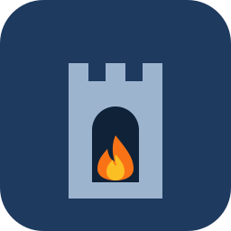

<p align="center">
  
</p>

# Blaustein LED

[](https://github.com/greluc/blaustein-led/actions/workflows/ci.yml)
[](https://github.com/greluc/blaustein-led/actions/workflows/repository-gates.yml)
[](#license)
[](CODE_OF_CONDUCT.md)

Blaustein LED is the firmware for the campfire lights of Burg Blaustein: a smooth, configurable
flicker on up to sixteen LEDs, driven by a Raspberry Pi Pico 2 (RP2350). A channel table assigns
every LED a light role (hearth, torch, candle, ember, ambient light) or lets it follow another
channel, and trims it to its LED. Each LED runs its own simulation with its own seed; its motions
have no fixed period and no phase shared with another LED, so the flames never move in lockstep.
After power-on the lights come up one after another, and every power-on looks different. A
watchdog brings the effect back on its own if it ever stops.

The current release is **[2.0.0](https://github.com/greluc/blaustein-led/releases/tag/v2.0.0)**.
Blaustein LED is written in Rust with [Embassy](https://embassy.dev) and licensed under either of
the [Apache License, Version 2.0](LICENSE-APACHE) or the [MIT licence](LICENSE-MIT) at your option.
The source lives at [github.com/greluc/blaustein-led](https://github.com/greluc/blaustein-led).

## What it does

- **Flame.** Three layers of smoothly interpolated value noise pull the light below its peak: a
  slow swell, a faster sway and a fast flicker. Each layer glides to a new random level after a
  random time from its configured range, easing in and out, so nothing repeats and no two LEDs
  share a phase. Occasional gusts deepen the flicker for a moment. The result is a 16-bit
  perceived intensity, mapped through a square-law gamma curve to 25 kHz PWM.
- **Light roles.** Presets for a hearth, a torch, a candle, embers and ambient room light, and a
  follower for a second light driven by another channel, such as the red glow of the embers under
  a fireplace flame. One parameter, `peak`, bounds the brightness of a role without changing how it
  moves.
- **Channel table.** One line per LED assigns its role or the channel it follows, and a trim that
  evens out LEDs of the same type without touching the role. The installed table is the draft
  channel plan of [docs/lighting-plan.md](docs/lighting-plan.md).
- **Staggered ignition.** After power-on every channel stays dark until its turn and then fades
  in, about 400 ms after the one before it, within 2 s. A follower lights after its flame.
- **Different at every power-on.** 32 random bits from the ring oscillator of the RP2350 are mixed
  into the seeds at boot. The read is bounded and cannot fail; every value gives valid seeds.
- **Staggered PWM phases.** The PWM slices start together, with their counters spread evenly over
  the period, so the LEDs do not all switch on at the same instant.
- **Identify build.** With the `identify` feature every LED blinks its channel number counted
  from 1, so thin wires can be matched to channels during the installation.
- **One to sixteen channels, one task.** GPIO 7 to GPIO 22 reach all sixteen PWM outputs of the
  Pico 2, each with its own light. The number of entries in the channel table sets how many are in
  use; only those get a simulation, a PWM slice and RAM. One task and one `Ticker` drive them all,
  so the cadence never drifts.
- **Integer only.** No floating point and no allocation. The configuration is a compile-time
  constant, so every derived value folds into the binary. A channel needs 36 bytes of RAM. The
  release image uses about 5.2 KB of flash and 472 bytes of static RAM for one LED, and 6.5 KB and
  1120 bytes for sixteen; the identify build 4.5 KB and 544 bytes for sixteen.
- **Unattended.** In deployed builds a panic resets the chip instead of halting, and a watchdog,
  started right after the clocks are set up, resets it if anything stops the effect. Nothing writes to flash, so
  cutting the power is safe. Invalid configurations fail the build.

## Hardware

- Board: Raspberry Pi Pico 2 (RP2350A).
- LEDs: amber or orange for flames, red for embers, warm white for candles and room light.
- Pins: GPIO 7 to GPIO 22, one LED each. GPIO `n` is PWM channel `n mod 16`, so this block uses
  every PWM output of the RP2350A exactly once. The entries of the channel table take the pins in
  the order GPIO 16 to GPIO 22, then GPIO 7 to GPIO 15 (slice by slice, A before B):

  | PWM slice | 0 | 1 | 2 | 3 | 4 | 5 | 6 | 7 |
  | --- | --- | --- | --- | --- | --- | --- | --- | --- |
  | Channel A | GPIO 16 | GPIO 18 | GPIO 20 | GPIO 22 | GPIO 8 | GPIO 10 | GPIO 12 | GPIO 14 |
  | Channel B | GPIO 17 | GPIO 19 | GPIO 21 | GPIO 7 | GPIO 9 | GPIO 11 | GPIO 13 | GPIO 15 |

- Wiring per channel: GPIO → series resistor → LED anode; LED cathode → GND. Start with about
  1 kΩ for amber, orange and red and about 330 Ω for warm white.

Use a series resistor on every channel. The firmware assumes active-high LEDs. A GPIO drives only
a few milliamperes, and the sum over all pins is limited as well: plan for at most 4 mA per pin and
40 mA in total. For more than two LEDs or more brightness on a channel, switch the LEDs through a
small logic-level MOSFET.

[docs/hardware.md](docs/hardware.md) holds the full electrical design, the power supply and the
installation in the model; [docs/lighting-plan.md](docs/lighting-plan.md) holds the lighting
concept and the channel plan.

## Configuration

The installed values live in [`src/config.rs`](src/config.rs). The types are defined in
[`fire-effect/src/installation.rs`](fire-effect/src/installation.rs),
[`fire-effect/src/lighting.rs`](fire-effect/src/lighting.rs),
[`fire-effect/src/channel.rs`](fire-effect/src/channel.rs),
[`fire-effect/src/config.rs`](fire-effect/src/config.rs),
[`fire-effect/src/follower.rs`](fire-effect/src/follower.rs) and
[`fire-effect/src/ignition.rs`](fire-effect/src/ignition.rs); the presets in
[`fire-effect/src/roles.rs`](fire-effect/src/roles.rs). Everything is a compile-time constant, and
an invalid value fails the build with an explanatory message instead of producing dead firmware.

`INSTALLATION` holds what every LED shares, so two roles cannot disagree on it:

| Parameter | Type | Meaning |
| --- | --- | --- |
| `pwm_freq_hz` | `u32` | PWM frequency. 20 to 30 kHz keeps PWM inaudible and flicker-free. |
| `pwm_divider` | `u8` | PWM clock divider, at least 1. Use the smallest value that keeps `top` within `u16`. |
| `tick_ms` | `u32` | Update interval in milliseconds. 10 to 20 ms works well; the presets need at most 20. |

`LIGHTING` holds the lights:

| Field | Type | Meaning |
| --- | --- | --- |
| `hearth`, `torch`, `candle`, `ember`, `ambient` | `FireConfig` | The look of every channel of that role. Every look is checked, also one no channel uses. |
| `glow` | `FollowerConfig` | The follower of every `Light::Follows` channel. |
| `ignition` | `IgnitionConfig` | How the channels light after power-on. |
| `channels` | `&[Channel]` | The channel table, one entry per LED. |

### Channel table

Each entry is `Channel::new(light, trim_permille)`, in the pin order of the table under
[Hardware](#hardware): the first entry drives GPIO 16, the eighth GPIO 7. The number of entries
(1 to 16) is the number of LEDs in use. Changing a channel is a one-line edit:

```rust
channels: &[
    Channel::new(Light::Hearth, 1_000),     // 0, GPIO 16: base castle, hall, fireplace flame
    Channel::new(Light::Follows(0), 1_000), // 1, GPIO 17: base castle, hall, its embers
    Channel::new(Light::Hearth, 1_000),     // 2, GPIO 18: base castle, kitchen, cooking fire
    Channel::new(Light::Candle, 800),       // 3, GPIO 19: base castle, bedroom, a bright LED
    // ...
],
```

- **Role.** `Light::Hearth`, `Light::Torch`, `Light::Candle`, `Light::Ember` or `Light::Ambient`
  runs that role's look with the channel's own seed.
- **Follower.** `Light::Follows(n)` runs `glow` on the output of channel `n`, such as the red embers
  under a fireplace flame. Channel `n` must come earlier in the table and must not be a follower
  itself.
- **Trim.** `trim_permille` evens out LEDs of the same type: 1000 shows the role as configured,
  lower values dim the LED without changing how it moves. It scales the intensity, so 500 looks
  about half as bright. A trim only dims; for more light on every LED of a role, raise its `peak`.
  The trim of a flame does not reach its follower.

The installed table is the draft of [docs/lighting-plan.md](docs/lighting-plan.md): hearths on
channels 0, 2, 5 and 7, the glow of the hall fireplace on channel 1, torches on 4, 6, 10 and 14,
candles on 3, 8, 9, 11 and 15, the forge as embers on 12 and ambient light on 13, all at a trim of
1000. An entry that follows itself, a later channel, a follower or a channel beyond the table, a
trim of 0 or above 1000, or an empty table fails the build, for example with
`a channel can only follow an earlier channel, which is updated before it within a tick`.

### Looks

A `FireConfig` is the look of a light role. Its output never exceeds `peak` and never falls below
`peak × (1000 − total depth) / 1000`, where the total depth is the sum of the four depths. Because
every depth is a share of `peak`, changing `peak` makes the light brighter or dimmer without
changing how it moves:

| Parameter | Type | Meaning |
| --- | --- | --- |
| `peak` | `Intensity` | The highest intensity the light ever reaches, for example `Intensity::from_permille(600)` for 60 % of full scale. The only bound of the brightness. |
| `swell`, `sway`, `flicker` | `Layer` | Three layers of value noise, from slow to fast. |
| `depth_permille` | `u16` | Of a layer: how far it pulls the light below `peak` at most, in thousandths of `peak`. 0 switches it off (`Layer::OFF`). |
| `min_ms` / `max_ms` | `u32` | Of a layer: shortest and longest glide to the next random level. `min_ms` spans at least two ticks. |
| `gust` | `Gust` | Occasional gusts that deepen the flicker; they follow the timing of `flicker`. `Gust::OFF` switches them off. |
| `depth_permille` | `u16` | Of a gust: extra pull at its start in thousandths of `peak`. The four depths add up to at most 1000. |
| `mean_interval_ms` | `u32` | Of a gust: mean time between two gusts. |
| `duration_ms` | `u32` | Of a gust: time in which it fades out. |

The presets are starting points tuned in a host simulation; adjust them on the real model:

| Preset | Light | Peak | Look |
| --- | --- | --- | --- |
| `FireConfig::HEARTH` | Fireplace, cooking fire | 90 % | Irregular swell over 1 to 3 s, lively flicker, a gust every 8 s. |
| `FireConfig::TORCH` | Torch | 75 % | Fast and restless, small swing, a strong gust every 6 s. |
| `FireConfig::CANDLE` | Candle, oil lamp | 50 % | Almost steady, a short twitch every 20 s. |
| `FireConfig::EMBER` | Embers, forge | 40 % | Very slow, small swing, no fast flicker. |
| `FireConfig::AMBIENT` | Room light | 25 % | Constant dim level with about 5 % of unrest. |

To change a look, pick another preset or override fields of one with struct update syntax; the
change applies to every channel of that role (import `Gust` and `Intensity` from `fire_effect`):

```rust
candle: FireConfig {
    peak: Intensity::from_permille(400),
    gust: Gust::OFF,
    ..FireConfig::CANDLE
},
```

A `FollowerConfig` drives a light from another channel: it smooths the source's intensity with a
time constant of `smoothing_ms` and outputs `floor + smoothed × gain_permille / 1000`, saturating
at full scale. `FollowerConfig::HEARTH_GLOW` is the red glow of the embers under a hearth flame.

An invalid combination, for example depths that add up to more than 1000 permille or a glide
shorter than two ticks, fails the build with a message such as
`sway.min_ms must span at least two ticks, or the layer jumps instead of gliding`.

### Ignition

After power-on, channel `n` (counted from 0) stays dark for `n × delay_ms` and then fades in
linearly within `fade_ms`. Both are rounded down to whole ticks; `delay_ms: 0` lights every
channel at once. A follower comes after its flame in the table, so it never glows before the
flame, and it is fed the flame as it lights, so the embers heat up with it.

| Parameter | Type | Installed | Meaning |
| --- | --- | --- | --- |
| `delay_ms` | `u32` | 400 | Time from the start of one channel to the start of the next. |
| `fade_ms` | `u32` | 2000 | Time in which a channel fades in from dark, at least one tick and at most 65,536 ticks. |

At the 15 ms tick the installed values round to 390 ms and 1995 ms, so with sixteen channels the
last one starts after about 6 s and is fully lit after about 8 s.

## Build and flash

Requires [rustup](https://rustup.rs) and, to flash, [picotool](https://github.com/raspberrypi/picotool)
on your `PATH`. `rust-toolchain.toml` selects the stable toolchain (1.99.1 or newer) and installs
the `thumbv8m.main-none-eabihf` target on first use.

1. Hold BOOTSEL while plugging in the Pico 2.
2. Build and flash in one step: `cargo run --release`.

`cargo run` uses the `picotool` runner from [`.cargo/config.toml`](.cargo/config.toml). To flash by
hand, build with `cargo build --release` and load
`target/thumbv8m.main-none-eabihf/release/blaustein-led` with `picotool load -x -t elf`. Every CI
run also uploads that image as the `blaustein-led-elf` artifact.

| Profile | Command | Purpose |
| --- | --- | --- |
| `release` | `cargo build --release` | Deployment. No defmt stack; a panic resets the board so the installation recovers unattended. |
| `release` with `identify` | `cargo build --release --features identify` | Installation aid, see [Identify build](#identify-build). |
| `release-debug` | `cargo build --profile release-debug --features debug` | Optimised build that keeps the symbol table defmt needs to decode RTT output. A panic halts for an attached debugger. |
| `dev` | `cargo build` | `opt-level = 1`, full debug info. |

Set the log level of `debug` builds with `DEFMT_LOG` (default `info`, set in `.cargo/config.toml`).

### Identify build

`cargo run --release --features identify` flashes an installation aid instead of the fire: every
LED blinks its position in the channel table counted from 1, so a wire can be matched to its
channel. The table and the channel plan count from 0, so channel 0 (GPIO 16) flashes once and
channel 15 (GPIO 15) sixteen times. All channels start together, each flash lasts 150 ms with
250 ms of dark in between, and after the flashes of the last channel all LEDs stay dark for 2 s
before the pattern repeats. Flashes are at full scale and ignore the trim.
The watchdog and the resetting panic handler work as in the default build, and `picotool info`
shows the build by its program description. Flash the default build again when the wiring is
done.

## Development

| Step | Command |
| --- | --- |
| Format | `cargo +nightly fmt --all` |
| Lint the firmware | `cargo clippy --release`, `cargo clippy --release --features identify` and `cargo clippy --profile release-debug --features debug` |
| Lint the effect crate and its tests | `cargo clippy-host` |
| Test | `cargo test-host` |
| Check dependencies | `cargo deny check` |

`Cargo.toml` denies every Clippy group (`all`, `pedantic`, `nursery`, `cargo`), a set of
restriction lints that fit an integer-only `no_std` firmware, and all compiler warnings.
`rustfmt.toml` enables the strict formatting options, most of which need the nightly `rustfmt`;
the code itself builds on stable. CI runs all of the above on every pull request.

### Project layout

| Path | Content |
| --- | --- |
| [`fire-effect/`](fire-effect/) | The flicker simulation, the light-role presets, the follower, the channel table and its validation, the ignition, the identify pattern, the seed mixing, the gamma curve, PWM timing and slice phases. No hardware dependencies, so its tests run on the host (`cargo test-host`, an alias for `cargo test --package fire-effect --target host-tuple`). |
| [`src/main.rs`](src/main.rs) | The firmware: wires the pins to the PWM slices, the watchdog, the panic handler and the task that shows the effect. |
| [`src/config.rs`](src/config.rs) | The installed `INSTALLATION` and `LIGHTING` with the channel table; `CHANNELS` follows from the table. |
| [`src/outputs.rs`](src/outputs.rs) | The PWM slices: routing, staggered phases and the duty values of every tick. |
| [`src/effect.rs`](src/effect.rs) | The effect of the build: the fire, seeded from the ring oscillator, or the identify pattern. |
| [`memory.x`](memory.x), [`build.rs`](build.rs) | Memory layout of the RP2350 and the linker setup. |
| [`.github/`](.github/) | CI, repository gates, Dependabot, issue and pull request templates, security policy. |
| [`docs/design/`](docs/design/) | The logo (`logo.svg`) and the GitHub social preview (`social-preview.svg`, rendered to `social-preview.png`). |

## Documentation

| Topic | Document |
| --- | --- |
| Lighting concept, channel plan and the analysis behind them | [docs/lighting-plan.md](docs/lighting-plan.md) |
| Wiring, power supply, installation and bill of materials | [docs/hardware.md](docs/hardware.md) |
| Research still to do, as a brief for a session with internet access | [docs/research-brief.md](docs/research-brief.md) |
| Contributing, checks and commit rules | [CONTRIBUTING.md](CONTRIBUTING.md) |
| Reporting a vulnerability | [.github/SECURITY.md](.github/SECURITY.md) |
| Code of Conduct | [CODE_OF_CONDUCT.md](CODE_OF_CONDUCT.md) |
| Release notes | [CHANGELOG.md](CHANGELOG.md) |
| Instructions for coding agents | [CLAUDE.md](CLAUDE.md) |

## Contributing

Read [CONTRIBUTING.md](CONTRIBUTING.md) first: the checks, the tests and the sign-off of every
commit. Security issues are reported as described in [.github/SECURITY.md](.github/SECURITY.md).
Everyone taking part is bound by the [Code of Conduct](CODE_OF_CONDUCT.md).

## License

Licensed under either of

- Apache License, Version 2.0 ([LICENSE-APACHE](LICENSE-APACHE) or
  <https://www.apache.org/licenses/LICENSE-2.0>)
- MIT licence ([LICENSE-MIT](LICENSE-MIT) or <https://opensource.org/licenses/MIT>)

at your option.

Unless you explicitly state otherwise, any contribution intentionally submitted for inclusion in
the work by you, as defined in the Apache-2.0 licence, shall be dual licensed as above, without any
additional terms or conditions.

[](https://www.rust-lang.org/)
