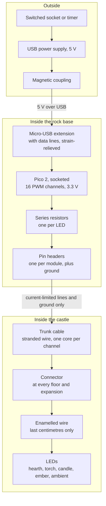

# Hardware

How the lights of Burg Blaustein are wired, powered and installed. This is the design for the full
build: the base castle, every expansion and the side buildings. Nothing of it is installed yet, so
every value marked as an assumption is confirmed on the bench before it goes into the model. The
reasons behind the design and the list of open points are in [lighting-plan.md](lighting-plan.md).

## Overview

Everything electrical sits in the rock base. Only the short end of the power lead with its coupling
shows outside, and only current-limited LED lines and ground run into the castle.

## Electrical design

Every LED has its own series resistor and hangs directly on its PWM pin: GPIO → resistor → LED
anode, LED cathode → ground. The resistors sit on the board in the rock base. No driver stage is
needed at these currents, for three reasons:

- At power-on the pins are high impedance and the LEDs stay dark until the firmware runs. With
  transistors, every stage would need a pull-down.
- The LED current comes from the regulated 3.3 V rail of the Pico 2, so ripple of a cheap power
  supply does not show as flicker.
- The shortest PWM pulses are about 240 ns long (36 counts at 150 MHz and 25 kHz). A GPIO switches
  that cleanly. A Darlington array such as the ULN2803A is assumed to be too slow for it; its
  datasheet has not been checked.

### Series resistors

| LED | Assumed forward voltage | Starting resistor | Current |
| --- | --- | --- | --- |
| Amber, orange | 2.0 V | 1 kΩ | 1.3 mA |
| Red | 1.9 V | 1 kΩ | 1.4 mA |
| Warm white | 2.8 V | 330 Ω | 1.5 mA |

The forward voltages are typical values at low current, not manufacturer data. Recalculate with the
datasheet of the LEDs that are bought: `R = (3.3 V − Vf) / I`. The resistor sets the brightness
coarsely, the firmware sets it finely.

### Rules

- **Warm white is tight.** Only about 0.5 V remain for the resistor, so the brightness varies from
  LED to LED. Trim every warm white LED on its own.
- **Check pre-wired LEDs.** Many carry a built-in resistor for 12 V; one offer states 1.5 kΩ. On
  3.3 V they stay very dim. Buy them without a resistor or remove it.
- **Current budget.** The channel plan reaches about 39 mA with up to 28 LEDs if all of them are
  fully on at once; the average is far lower. The design limits are 40 mA in total and 4 mA per
  pin. The permitted total GPIO current of the RP2350 has not been looked up; for the RP2040 it is
  50 mA from memory.
- **No ground over enamelled wire.** Enamelled copper wire of 0.1 mm has 2.2 Ω per metre. If one
  such wire carried the ground of all channels over 1.5 m, 0.12 V would drop across it and the
  channels would modulate each other. Ground runs to the board as stranded wire of 0.14 mm² per
  module; the Pico 2 has eight ground pins for that.
- **Shorts are harmless.** If a wire chafes through, at most 10 mA flow. This holds as long as
  neither 5 V nor 3.3 V runs into the castle as a supply line.
- **More than two LEDs or more brightness per channel.** Only then a small logic-level MOSFET as a
  low-side switch pays off, with 100 kΩ from gate to ground.
- **Inputs added later.** Buttons or sensors need external resistors on an RP2350 of revision A2,
  whose internal pull-down is affected by erratum E9.

## Power supply

The Pico 2 is powered through its USB socket: from there a diode feeds VSYS (about 1.8 V to 5.5 V
permitted) and the regulator makes 3.3 V. The demand is estimated at well below 100 mA, less than
0.5 W; the figure in the Pico 2 datasheet has not been looked up. Any USB power supply is enough.

| Variant | Build | Advantages | Drawbacks |
| --- | --- | --- | --- |
| A: magnetic coupling (chosen) | Extension from the Pico to the edge of the rock, magnetic adapter in its socket, magnetic cable to the power supply | Releases by itself when pulled, separates with one hand, spares the castle and the socket | Quality varies, many adapters carry no data, exposed contacts on the cable end, some have an LED in the plug |
| B: USB-C panel socket | Socket flush in the rock, adapter to Micro-USB inside, a normal USB-C cable outside | Nothing hangs out, standardised, data possible | Does not release when pulled. Without 5.1 kΩ resistors on CC1 and CC2, USB-C power supplies deliver nothing over a C-to-C cable |
| C: barrel plug on VSYS | Coupling 5.5/2.1 mm, inside through a Schottky diode to pin 39 | Sturdy, cheap, the USB socket stays free | No data, soldering |

- **Lead.** A Micro-USB extension of 15 cm to 30 cm, plug to socket, fully wired with data lines,
  thin and flexible, with an angled plug at the Pico. Pull the magnetic adapter out and a normal
  Micro-USB data cable fits the same socket for flashing. The firmware feature `usb-update` uses
  these data lines: picotool on a computer at the other end reboots the Pico into its bootloader
  and flashes it without the BOOTSEL button.
- **Strain relief.** Tie the lead to a Technic brick inside the rock. The socket of the Pico must
  never take a pull.
- **Coupling without an LED.** A lit status indicator at the foot of the rock spoils the picture;
  cover it otherwise.
- **Switching.** An inline switch, a timer or a smart plug at the power supply. The firmware never
  writes to flash and keeps no state, so cutting the power is safe.
- **No power bank.** Many switch off after a short time at such a small current.
- **No double feed.** Feeding 5 V into the VBUS pin as well would feed back into the PC while
  flashing.

## Installation

The rock base of the base castle is hollow and reachable, so the control board goes there. Nothing
is drilled.

### Control board

- A perfboard of about 50 mm × 70 mm, roughly 6 × 9 studs, with socket strips for the Pico 2
  (51 mm × 21 mm), the series resistors and one pin header per module as outlet.
- The Pico is only plugged in. It comes out for flashing without loosening a wire.
- A removable piece of rock serves as the maintenance hatch.

### Cabling

- A trunk cable of thin stranded wire runs from the board to every module: one core per channel
  plus ground.
- In the module it ends at a small solder or pin strip. The enamelled wires of the LEDs start
  there.
- Enamelled wire is for the last centimetres only; it breaks when moved repeatedly.

### Separation points

- The base castle has three removable floors according to a review. Every floor with LEDs gets a
  small connector in a wall niche or in the chimney shaft, with 3 cm to 5 cm of slack.
- Every expansion gets a connector at its joint, so the castle stays separable.

### Routing without drilling

1. Lead enamelled wire between the studs under a brick or a plate, never across a stud. At most one
   or two wires per joint.
2. Run vertically in chimneys, tower shafts and behind columns. Stacked round 1×1 bricks with a
   hollow stud form a duct.
3. Pass walls through windows, arrow slits and door arches. Where nothing is open, swap a brick for
   a Technic brick with a hole; that is reversible.
4. Fix with removable adhesive putty. No superglue, it leaves a white haze.

These are common techniques of lighting brick models and have not been tried on this set. Check on
spare bricks first whether the bricks still clamp cleanly with a wire in the joint.

### Light placement

- An LED is never visible directly. It lights a transparent part or a wall.
- The fire stays the brightest and most restless source in a room; ambient light stays well below.
- Light bricks are slightly translucent. Keep LEDs away from the back of an outer wall, or put a
  black plate or aluminium tape in between. This is an experience value to be checked on the model.

### Before installing

- Test every LED on the board and mark its polarity.
- Label every wire with its channel number.
- Match the wires with the identify build (`cargo run --release --features identify`): every LED
  blinks its channel number counted from 1, so channel 0 flashes once and channel 15 sixteen times.
- Photograph the installation and keep the channel plan in this repository up to date.

## Bill of materials

Quantities follow the channel plan with some reserve. Prices and concrete articles have not been
researched.

| Part | Quantity | Note |
| --- | --- | --- |
| Raspberry Pi Pico 2 with pin headers | 1 | |
| Socket strip 1×20, 2.54 mm pitch | 2 | Socket for the Pico |
| Perfboard, about 50 mm × 70 mm | 1 | |
| Resistors 330 Ω, 470 Ω, 680 Ω, 1 kΩ, 1.5 kΩ | 20 each | One per LED, the rest for trimming |
| SMD LED 0402 amber or orange, pre-wired | 15 | Without built-in resistor, 12 needed |
| SMD LED 0402 red, pre-wired | 8 | 5 needed |
| SMD LED 0402 warm white, pre-wired | 15 | 2000 K to 2700 K if available, 11 needed |
| Stranded wire 0.14 mm² in several colours | 10 m | Trunk cables and ground |
| Pin and socket strips, 2.54 mm pitch or smaller | as needed | Connectors at the board, floors and modules |
| Micro-USB extension, angled plug to socket, 15 cm to 30 cm | 1 | With data lines |
| Magnetic Micro-USB adapter with cable | 1 | Without an LED in the plug |
| USB power supply 5 V, at least 0.5 A | 1 | Branded, with CE mark |
| Inline switch, timer or smart plug | 1 | Optional |
| Technic bricks with a hole in the wall colour | as needed | Wall feed-throughs |
| Removable adhesive putty, black or aluminium tape, small cable ties | | Fixing, shielding, strain relief |
