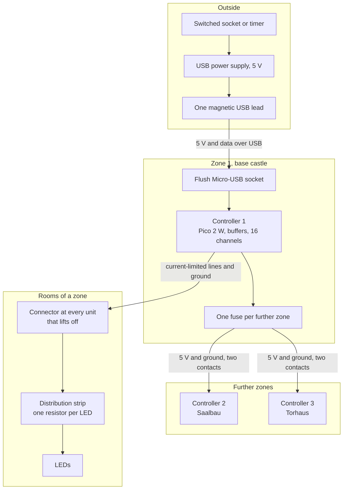
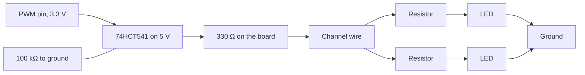
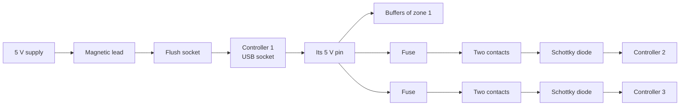

# Hardware

How the lights of Burg Blaustein are wired, powered and installed. This is the design for the full
build, which grows in stages. Nothing of it is built yet, so every value marked as an assumption or
a starting value is confirmed on the bench before it goes into the model. The reasons behind the
design are in [lighting-plan.md](lighting-plan.md), the parts with their prices in
[bill-of-materials.md](bill-of-materials.md), the model itself in [model.md](model.md) and every
source in [sources.md](sources.md).

## Overview

The castle is divided into zones of neighbouring sets. Each zone has one controller on a small
board, hidden in the model. One power lead enters the castle; inside, fused 5 V branches run from
the first controller to the others. Beyond a controller only current-limited lines and ground run
to the LEDs.

## Zones and controllers

A controller serves as many sets as it can: the rule is as many controllers as necessary and as few
as possible. A new controller is added only when the 16 channels of the last one are used up, or
when a trunk would have to cross a boundary that the next building instruction takes apart.

| Controller | Arrives with | Sits | Serves |
| --- | --- | --- | --- |
| 1 | Stage 1, the base castle with the Bergfried | In the chamber under the terrace of the base castle | Base castle, Bergfried, and from stage 2 the Vorburg |
| 2 | Stage 3, the Saalbau | In the Saalbau; cellar, pillar or roof, to be chosen on the model | Saalbau, the galleries of the Hurde, the Münzturm |
| 3 | Stage 6, the Torhaus | In the Torhaus; stair tower or roof | Torhaus, Schildwerk |
| 4 | Stage 8, the side buildings | In the display base or in one of the side buildings | Rüstmeister, Stallungen, Zehntscheune |

Three controllers light the castle. Two would do by the count of channels; the third saves trunks
across the whole model.

### The controller

A Raspberry Pi Pico 2 W, in the variant with soldered headers, on socket strips.

| Property | Value |
| --- | --- |
| Chip | RP2350A, as on the Pico 2 the owner has, which stays the test device |
| Size | 51 mm × 21 mm, 1 mm thick, Micro-USB at one end |
| Hardware PWM | 16 channels, 6000 counts at 25 kHz. The pins of the firmware, GPIO 7 to 22, are all free; the radio uses GPIO 23, 24, 25 and 29 |
| Radio | 2.4 GHz wireless LAN and Bluetooth 5.2. The antenna is at the end opposite the USB socket and needs a free zone of 14 mm × 9 mm; nothing of metal may enclose it, so no aluminium tape near that end |
| Supply | 5 V through the USB socket, or through the VSYS pin behind a Schottky diode, which is the way its datasheet names for a second source |
| Start | It runs as soon as it has power |

- **Why the radio.** The first controller is reached by the power lead. The others are not, and
  nobody wants to open a module to update one. The radio is the update path for all of them, and it
  can carry settings such as the brightness of a channel. It is switched on in a service window
  only.
- **Not proven yet.** A Rust driver for the radio chip exists, and so does a bootloader library,
  whose description names the RP2040 only. An update over the radio on an RP2350 is the first
  milestone on the bench. The fallback is the USB socket of each controller.
- **Other boards were examined.** A board with the RP2350B has 24 channels, but it is 76 mm long,
  costs three times as much, and no zone needs more than 16 channels. No other controller family
  dims finer at 25 kHz. The comparison is in [lighting-practice.md](lighting-practice.md).

### The board of a zone

A perfboard with socket strips for the controller, two buffers in sockets, a protective resistor per
channel and the outlets. It is the same in every zone. A layout has not been drawn; whether the
board with the USB plug fits the chamber under the terrace, about 80 mm × 80 mm and 38 mm to 48 mm
high by the drawings, is measured on the model before the board is built.

## Driver stage

Every channel runs through a logic buffer on 5 V: pin of the controller → input of a 74HCT541 →
output → protective resistor on the board → wire → resistor of the LED on the distribution strip of
its room → LED → ground.

| Part | Role |
| --- | --- |
| Two 74HCT541 per controller, in sockets | Eight buffers each. They run on the 5 V of the supply and read 2.0 V as high, so a 3.3 V pin drives them directly. Both enable inputs are tied to ground |
| A 100 kΩ resistor network per buffer | Holds the inputs low while the pins of the controller are still unpowered or high impedance, so the LEDs stay dark until the firmware runs |
| A 100 nF capacitor per buffer | Decoupling |
| A 330 Ω resistor per output | Limits a short of a channel wire to 15 mA |

Why a buffer and not the pin itself:

- **Warm white needs it.** A warm white LED of the chosen kind needs typically 2.7 V and at most
  3.3 V at 5 mA, and it is about five times as bright as an orange one at the same current. A
  candle therefore runs at a fraction of a milliampere. From a 3.3 V pin that current comes out of
  a headroom of about half a volt, where the spread between LEDs decides the brightness. From 5 V
  the headroom is more than 2 V and the resistor decides.
- **One wire per channel.** The resistors of the LEDs sit in the rooms, so a channel with five
  candles crosses a joint on one contact.
- **Nothing but limited lines beyond the board.** A chafed wire in a room carries at most 15 mA.
- **The pins are out of reach.** A fault on a wire meets a socketed part that costs less than a
  euro.

The current of the LEDs comes from the 5 V of the supply. The supply of the bill of materials is
specified with at most 100 mV of ripple, which is up to 5 % of the headroom. That this stays
invisible is an assumption for the bench test. The pins of the RP2350 may source 100 mA in total and
reset to a drive strength of 4 mA; neither limit matters, because they only drive buffer inputs.

A Darlington array as a low-side switch was examined and rejected: it switches off about 110 ns
later than it switches on, against shortest pulses of 240 ns, and drops about 0.9 V.

### Resistors of the LEDs

The resistor of an LED is `R = (Vm − Vf) / I`, with `Vm = Vout − 330 Ω × Ichannel` at the room. The
starting values assume 5.0 V at the output of the buffer and the forward voltages of the datasheet
at 5 mA. Neither is exact: the output lies a few tenths of a volt lower under load, the supply may
deliver 4.75 V to 5.25 V, and no source states the forward voltages at the currents planned here.

| LED | Forward voltage, typical and maximum at 5 mA | Target | Starting resistor |
| --- | --- | --- | --- |
| Amber, flame of a hearth | 1.7 V, 2.3 V | 3 mA | 680 Ω |
| Amber, torch | 1.7 V, 2.3 V | 2 mA | 1 kΩ |
| Red, embers | 1.7 V, 2.3 V | 1.5 mA | 1.5 kΩ |
| Warm white, candle | 2.7 V, 3.3 V | 0.3 mA | 6.8 kΩ |
| Warm white, room light | 2.7 V, 3.3 V | 0.5 mA | 4.7 kΩ |

- The resistor sets the brightness of each LED once, the firmware sets the brightness of the
  channel. A dim light gets a large resistor and a moderate duty cycle, not a small resistor and a
  tiny one: the pulses stay long, and warm white looks warmer at a low current.
- A light that shares its channel gets a little less than one alone, because the protective
  resistor is shared. The bench sets the final values.
- The first bench test measures the forward voltage of every delivered LED at 0.3 mA, 1 mA and
  3 mA and confirms that its lead carries no resistor.

### Limits

| Limit | Value | Design |
| --- | --- | --- |
| Rated output current of a buffer | 6 mA | The plan peaks at about 3.5 mA, on the tiled stove with two LEDs |
| Absolute current through the supply pin of a buffer | 70 mA | Eight channels of 6 mA are 48 mA |
| Current of all LEDs fully on | About 60 mA for the castle | The average is far lower; the supply delivers 1.5 A |
| Short of one channel wire to ground | 15 mA through the protective resistor | Harmless |
| Short of a whole trunk | 15 mA per channel | With more than four channels of one buffer shorted at once, the absolute limit of its supply pin is exceeded. The buffer is socketed |
| Short between two channel wires | Up to 7.6 mA through both outputs; each lights the LEDs of the other | Above the rated 6 mA, far below the absolute 35 mA; easy to see |
| Short of a 5 V branch between two controllers | The fuse of the branch | See below |

## Power

One lead enters the castle, at the first controller. Everything else is fed from there.

| Link | Part | Notes |
| --- | --- | --- |
| Wall | A plain 5 V supply with a USB-A socket | Its datasheet allows a load of 0 A, so it does not switch off at a small one. A USB-A port delivers 5 V without any negotiation |
| Switch | A timer, a smart plug or a USB cable with a switch | The firmware keeps no state that a power cut could damage. A cable with a switch carries no data and comes out for an update over USB |
| Lead | A magnetic USB cable, USB-A to a magnetic face, 1.1 m | Specified by its maker for data up to 480 Mbit/s and 2.4 A. No independent test was found |
| At the model | The magnetic Micro-USB tip of that cable, in a flush panel socket with 25 cm of cable | The plug of that cable goes straight into the first controller. The socket needs an opening of about 8 mm × 3 mm and has two screw holes 30 mm apart |
| To a further controller | A resettable fuse on the board of the first controller, then 5 V and ground | One branch per controller. At the far end the 5 V feeds the buffers and, through a Schottky diode, the VSYS pin of the controller |

- **One cable leaves the castle.** The branches to the other controllers stay inside the model.
  When the castle moves onto the display base, the flush socket moves to the edge of the base and a
  longer cable of the same kind reaches the first controller.
- **The fuse limits a fault, it does not switch it off.** The chosen part holds 0.10 A and trips at
  0.20 A within seconds; while tripped it lets about 76 mA through. Whether a controller with its
  radio on stays below the hold current is measured before the value is fixed; the next size holds
  0.20 A.
- **The diode guards against two things:** a branch that is plugged in reversed, and a computer on
  the USB socket of that controller feeding the whole castle backwards.
- **Plugging a zone onto a live branch** charges its capacitors at once and may restart the other
  controllers for a moment. Switch the supply off first; nothing is damaged otherwise.
- **The magnetic coupling is an add-on to a normal socket.** If it disappoints, the tip is pulled
  out and an ordinary Micro-USB cable goes into the same socket. Its known weaknesses are open
  contacts that are live on the cable end and exposed to touch on the model, and a magnet that
  collects metal debris. Switch the supply off before detaching the lead.
- **The lead carries the data lines to the first controller.** The firmware feature `usb-update`
  uses them: picotool on a computer at the other end reboots that controller into its bootloader
  and flashes it without the BOOTSEL button.
- **To try on the samples:** whether the plug has an LED, whether data passes the whole chain and
  with the plug turned, whether the magnet lets go before the tip leaves its socket, and how far
  the tip stands proud.
- **No power bank.** Their makers document that the output switches off at small loads unless a
  special mode is entered, and that mode ends after two hours.

A Pico 2 draws typically 12.5 mA from 5 V. What a Pico 2 W draws with its radio on was not
researched; it is measured on the bench.

## Connectors

Inside a zone a joint carries one contact per channel and one for ground. Between two zones it
carries two contacts, 5 V and ground.

| Place | Connector | Notes |
| --- | --- | --- |
| Outlet of a board | The socket half of a 1.25 mm wire-to-wire pair, its leads soldered to the board | Plugging happens between two cables in free space |
| A unit that an instruction lifts off, such as the keep or the wooden yard | The same pair, with 3 cm to 5 cm of slack | Pulled apart by hand before the unit is lifted |
| A floor that lifts off often | A magnetic connector with spring contacts, two to four contacts at 2.54 mm pitch, in a printed brick where it is hidden, otherwise in a seat cut into an original | Lets go by itself. The magnet supplies the contact force, which matters on a floor that lies loose: four plain spring pins of 1.5 N would lift a floor lighter than about 610 g |
| A 5 V branch between two zones | A pair with two contacts | The diode at the far end makes a reversed plug harmless |
| Distribution strip in a room | A piece of perfboard | The trunk ends here; the resistors of the LEDs and their wires start here |

- **Pin 1 is ground on every connector.** Pins 2 and up carry the channels in ascending order.
- **Every half towards the controller is a socket, every half towards the LEDs a plug.**
- **Both halves carry the same label.** A swap lights the wrong lamps and harms nothing.
- The 1.25 mm pairs on sale are copies of a branded family without a datasheet, and one report
  calls copies with three and four contacts unreliable. They are tried thirty times before they are
  built in. The fallback is the branded original at about ten times the price.
- Contact plates of the makers of light kits carry two contacts. They fit a 5 V branch or a single
  channel, are about one plate high and clamp on studs. The current ones of Light My Bricks end in a
  plug of their own that cannot be joined to other wiring without an adapter; older ones and those
  of other makers have ordinary wires. None states a rating; a pair is worth a test on a loose
  floor at 0.3 mA. Details are in [lighting-practice.md](lighting-practice.md).

### Outlets of the first controller

| Outlet | Stage | To | Contacts | Channels |
| --- | --- | --- | --- | --- |
| Wired directly | 1 | Kitchen and courtyard, the same unit as the controller | | 0, 1, 8 |
| J1 | 1 | Hall, through the joint under its floor | 4 | 2, 3, 4 |
| | 1 | Bedroom, through the joint under its floor | 2 | 4 |
| J2 | 1 | Bergfried, at its foot | 5 | 5, 6, 7, 9 |
| J3 | 2 | Vorburg | 5 | 10, 11, 12, 13 |
| P2, P3 | 3, 6 | The 5 V branches to controllers 2 and 3 | 2 each | |

The outlets of the other controllers are fixed when their sets are built. An outlet is soldered to
its board when its stage comes.

## Working on the bricks

Where a brick has to change for the lighting, the owner set an order of preference:

1. **A brick that cannot be seen is replaced by a printed one.** The brick with the passage, the
   seat or the pocket already in it comes from the filament printer, see
   [printed-parts.md](printed-parts.md). The original stays whole and is kept, so nothing has to be
   bought and the model can go back to its original state.
2. **A brick that can be seen stays an original and is worked on.** A print matches neither the
   colour nor the gloss of the set. A visible brick may be drilled, cut and glued where it serves
   the lighting, on one condition: a matching replacement brick is ordered first.
3. **A shape the filament printer cannot make so that it clamps,** such as a 1×1 plate, is treated
   like a visible brick.

A brick counts as visible when any face of it shows in the finished model, from outside or in a
room that opens. In doubt it is visible. Which bricks are hidden is decided on the model; the
instructions do not show it reliably.

### Replacement bricks for the visible ones

- BlueBrixx sells no single bricks. Its spare-part service replaces missing and defective parts
  against the invoice and orders each from the maker, with three to eight weeks of delivery; a brick
  that was drilled on purpose does not qualify.
- The parts list at the end of an instruction shows a drawing and a quantity for each part, no part
  number and no colour name.
- The practical source is the Part Packs of BlueBrixx: bags of 25 to 200 pieces of one shape and
  colour for 4.95 € to 6.95 €. All wall and floor shapes exist in both greys, tan, dark tan,
  reddish brown and black, and the 1×1 slope of the fires in transparent red and two transparent
  oranges.
- Who makes the Part Packs is not stated, and whether their colour and clutch match the sets is
  unverified. Two or three bags are bought and compared with the set in daylight before the rest.
  If the greys differ visibly, they serve for practice, and the replacement of a visible brick has
  to come from a second copy of its set.
- The only guaranteed match is a second copy of a set. The tiles of the mantel in the hall that
  carry a pattern have no other source and stay untouched.

### What is done, in the order of its benefit

| Measure | In a hidden brick: printed | In a visible brick: the original | Risk |
| --- | --- | --- | --- |
| A seat for each LED, so the LED sits under or behind the transparent part of a fire or a candle | A printed carrier with the seat in it. A hole that prints too tight is opened with the pin vice | A hole of 1.2 mm to 1.5 mm through the part that carries the fire or the candle | Small. The carriers are cheap bricks |
| Passages for wires | A printed brick or plate with a duct in its roof or a notch in a side wall, so the tubes that clamp stay whole | A hole of 1 mm: through the centre of a stud from inside, where the dimple of the mould centres the drill; through a side wall midway between two studs; through a plate between its tubes. Never through a tube, a pin or a wall at a stud, which are the surfaces that clamp | Printed: a clutch that is too weak or too tight. Drilled: a drill that wanders or breaks, a misplaced hole |
| A seat for a floor connector | A printed brick with a pocket, so a bought magnetic pair sits flush | A pocket cut into a brick at the top of a wall and into the part above it | Medium. The connector must let go with less force than its brick clamps |
| Glue | | Only to lock an LED in its seat. A glue that washes off where a weak hold is enough; clear epoxy for an LED potted into a spare brick | Solvent cement marks the plastic. Cyanoacrylate fogs transparent parts and cannot be removed without attacking the plastic, so it stays away from the fires and the windows |
| Room for a board | Leaving out hidden bricks, not cutting the base; a printed carrier holds the board | | The base carries the rock panels and the foundation of the keep; which bricks are free shows on the model |

- **A printed brick goes in only after the calibration** of [printed-parts.md](printed-parts.md):
  it clamps slightly lighter than an original and sits between originals that interlock above and
  below it.
- **Tools for the originals.** A pin vice with sharp steel drills of 0.6 mm to 1.5 mm, a needle for
  the centre mark, the brick clamped or pressed onto a plate. A rotary tool melts the plastic at its
  usual speeds.
- **Every operation on an original is tried on a spare first,** and the spare is pressed back
  between two originals to see whether it still clamps.
- Documented failures of others are wandering and broken drills, melting at high speed and holes in
  the wrong place. Whitening and cracks around a hole were not described anywhere.

## Installation

### Wires

| Wire | Outer diameter | Where |
| --- | --- | --- |
| Enamelled copper wire of the pre-wired LEDs, 0.15 mm | 0.16 mm | From the LED to the nearest strip or passage. The only wire that may pass under the wall of a brick without a hole |
| Stranded micro cable, 0.014 mm² | About 0.28 mm | The runs inside a zone, through the passages in the bricks and between the studs |
| Leads of the connectors, 28 gauge, and stranded trunk wire | Up to about 1 mm | Trunks and the 5 V branches, in shafts, bays and the base |

- Enamelled wire copes with bending but not with a pull. It is fixed near the LED and near the
  strip, and it never bridges a joint that moves.
- A wire lies between the studs or in a passage, never across a stud. A brick is never forced onto
  a wire.
- The ground of a room runs through its trunk, not through enamelled wire.

### Routes

1. Vertically in the well shaft, the tower shafts, the pillar of the Saalbau and the joist bays
   under the floors, see [model.md](model.md).
2. Through walls by windows, arrow slits and door arches, and otherwise through a passage: a
   printed brick with a duct where it is hidden, a drilled original where it shows.
3. The sets that are still to be built get their wires while they are built. A documented build
   that did so hid its wires better than one wired afterwards.

### Light placement

- An LED is never visible directly. It lights a transparent part or a wall.
- The fire stays the brightest and most restless source in a room.
- Light bricks let light through. An LED stays away from the back of an outer wall, or a black
  plate, aluminium tape or a printed insert goes in between. This is to be checked on the model.

### Before installing

- Test every LED with its resistor on the bench and mark its polarity.
- Label every wire and both halves of every connector.
- Match the wires with the identify build (`cargo run --release --features identify`): every LED
  blinks its channel number counted from 1, so channel 0 flashes once and channel 13 fourteen
  times.
- Test every finished unit on its own before it goes onto the castle.
- Photograph the installation and keep the channel plan in this repository up to date.
